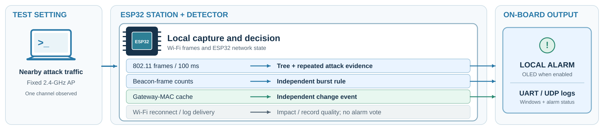
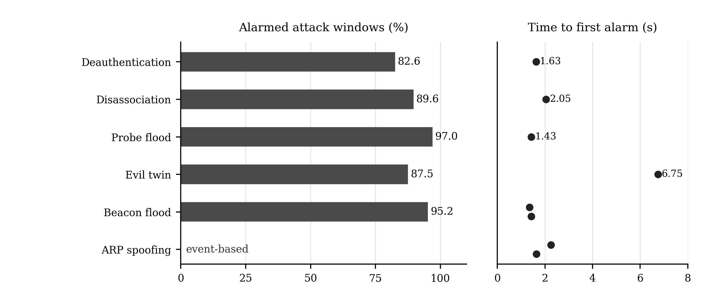

<!-- _class: lead -->
<!-- _paginate: false -->

# A Lightweight Multimodal IoT Intrusion Detection System on ESP32

Yun-Xiang Lin · Yan-Wei Chen · Tzu-Hao Hsu

National Sun Yat-sen University

<!--
0:00–0:30. Introduce the project as a team contribution.
“Good afternoon. Our project is a lightweight multimodal intrusion detection system running on an ESP32. We distinguish whether an attack is detected, whether the device is affected, and whether a useful response is possible.”
-->

---

## System architecture

**Wireless observations + local device state**

- A compact decision tree and protocol rules run on the ESP32.
- Gateway identity adds ARP coverage; connection events show device impact.
- OLED and a live USB dashboard make alerts and recovery visible.

<!--
0:30–1:10. Explain the two complementary sources and the three decision paths.
Source: the unchanged architecture figure from docs/mids_mid_project/report_figures/poster_system_architecture.svg. Gateway repair is a later demo extension; the original figure describes detection and telemetry.
-->

---

## Fixed-AP detection results

**8 attack runs, 6 scenarios.** One false-alarm episode in 3 h 57 min.

Alarm coverage measures detection during an attack, not successful blocking.

<!--
1:10–1:50. Explain alarmed-window coverage and first-alarm time. ARP is reported as an identity-change event, not a persistent window prediction.
Source: unchanged docs/mids_mid_project/report_figures/board_alarm_windows_and_delay.png and written-report Table V. These are the reported detection runs, distinct from the November protection campaign.
-->

---

## Live demonstration

### ARP spoofing

- Detect gateway impersonation
- Repair and lock the trusted gateway
- Check actual router replies

### Deauthentication

- Detect wireless attack traffic
- Observe a real Wi-Fi outage
- Reconnect and measure recovery

**Detection, protection, and recovery are separate outcomes.**

<!--
1:50–4:15. Switch to the live English dashboard. Launch each real attack with the prepared Kali terminal; do not use playback. Return to slide 5 by about 4:15, even if a recovery remains unconfirmed.
The first scenario is one-way ARP. The second demonstrates detection and recovery, not prevention of deauthentication. Full operator cues are in ../speaker_notes_en.md.
-->

---

## Takeaways

- **On-device detection:** six tested attack scenarios on a single AP.
- **Complementary sources:** wireless frames reveal attacks; host events add ARP coverage and endpoint context.
- **Visible response:** one-way ARP repair and automatic Wi-Fi recovery.

Two-way ARP remains unresolved. PMF is not enabled in this AP configuration.

<!--
4:15–5:00. Summarize team contributions and distinguish measured detection, targeted protection, and automatic recovery. Q&A follows for two minutes.
Source for protection limits: docs/demo_acceptance_results_20261118.md. Do not present the live demonstration as a new controlled protection-effectiveness experiment.
-->
